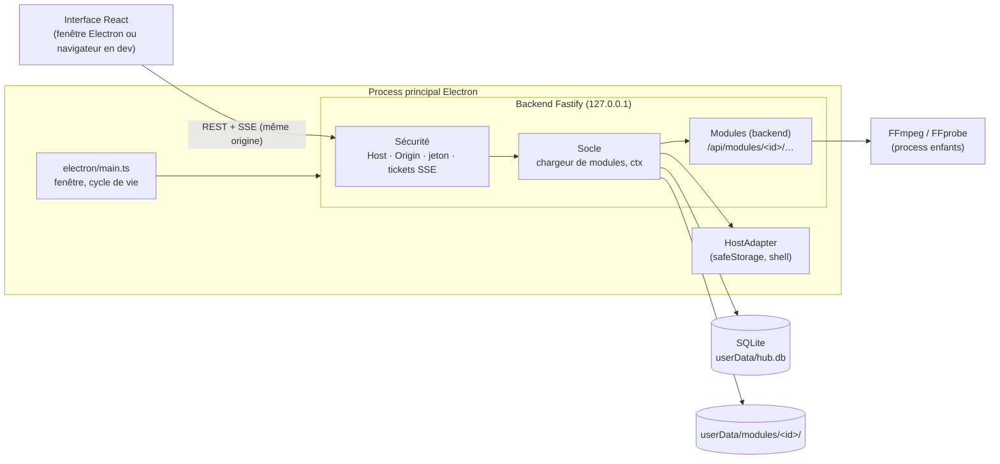

# Architecture

## Vue d'ensemble

ToolBox est une application Electron dont le process principal héberge un **backend HTTP local** (Fastify). L'interface React ne communique **qu'avec ce backend, via une API REST** : elle n'a aucun accès direct à Node, au disque ou à Electron. C'est ce qui permet de développer l'interface dans un navigateur classique.



| Couche         | Dossier         | Rôle                                                                                                                      |
| -------------- | --------------- | ------------------------------------------------------------------------------------------------------------------------- |
| Coquille       | `electron/`     | Crée la fenêtre, démarre le backend, fournit le `HostAdapter` (chiffrement, ouverture de dossiers), preload minimal.      |
| Socle backend  | `backend/`      | Serveur Fastify, sécurité, base SQLite, binaires FFmpeg ; à partir de la phase 1 : chargeur de modules et services `ctx`. |
| Socle frontend | `frontend/`     | Shell : accueil, navigation, réglages, client API, thème.                                                                 |
| Modules        | `modules/<id>/` | Outils métier, branchés sur le socle par le contrat de `docs/MODULES.md`.                                                 |

Le socle (`electron/`, `backend/`, `frontend/`) est **générique** : il ne connaît aucun module en particulier.

## Pourquoi le backend tourne dans le process principal

- `safeStorage` (chiffrement des jetons) n'existe que dans le process principal.
- Le backend ne fait pas de calcul lourd : les rendus vidéo et l'analyse audio sont des process FFmpeg enfants.
- Un seul process à gérer, un seul runtime Node (celui d'Electron).

Voir `docs/decisions/0001-electron-backend-dans-le-main.md`.

## Même origine, partout

| Mode             | Qui sert l'interface                             | URL chargée                          | Accès à l'API                  |
| ---------------- | ------------------------------------------------ | ------------------------------------ | ------------------------------ |
| Production       | le backend (`@fastify/static`, `build/renderer`) | `http://127.0.0.1:<port aléatoire>/` | relatif (`/api/...`)           |
| Dev (Electron)   | Vite (rechargement à chaud)                      | `http://localhost:5173/`             | proxy Vite → `127.0.0.1:47321` |
| Dev (navigateur) | Vite                                             | `http://localhost:5173/`             | idem, le proxy ajoute le jeton |

L'interface et l'API étant toujours servies depuis la même origine, **aucun en-tête CORS n'est jamais émis**.

## Sécurité de l'API locale

Une API sur `localhost` est joignable par tout process local et par toute page web ouverte dans le navigateur de l'utilisateur. Protections (`backend/core/security.ts`) :

1. **En-tête `Host`** : seuls `127.0.0.1:<port>` et `localhost:<port>` sont acceptés (protection contre le _DNS rebinding_).
2. **`Origin` et `Sec-Fetch-Site`** : une requête portant une origine étrangère ou marquée `cross-site` est refusée (protection CSRF). Les origines autorisées sont celle du backend, plus celle de Vite en dev.
3. **Jeton de session** : chaque route `/api/*` (sauf `/api/health`) exige l'en-tête `x-toolbox-token`. Le jeton est aléatoire (32 octets), régénéré à chaque lancement, et transmis à l'interface par le preload (`window.toolbox.token`). En dev navigateur, c'est le proxy Vite qui l'ajoute (`scripts/dev.mjs` le génère et le partage avec Electron).

### Flux SSE et tickets à usage unique

`EventSource` (Server-Sent Events, utilisé pour la progression des tâches) **ne peut pas envoyer d'en-têtes personnalisés**. Le jeton ne passe donc pas tel quel :

1. L'interface demande un ticket : `POST /api/core/stream-tickets` (avec le jeton en en-tête) → `{ "ticket": "…" }`.
2. Elle ouvre `new EventSource('/api/…?ticket=…')`.
3. Le backend accepte le ticket **une seule fois**, s'il a moins de **30 secondes**, et **uniquement** sur une route `GET` déclarée avec `config: { streamTicket: true }`.

Un ticket ne vaut donc que pour ouvrir un flux, et ne peut être ni rejoué ni utilisé sur une autre route. Pour se reconnecter après une coupure, l'interface redemande un ticket (la reconnexion automatique d'`EventSource` réutiliserait un ticket consommé : le client gère la reconnexion lui-même).

## Données

| Donnée               | Emplacement (Windows)                                    |
| -------------------- | -------------------------------------------------------- |
| Base SQLite          | `%APPDATA%\ToolBox\hub.db`                               |
| Fichiers des modules | `%APPDATA%\ToolBox\modules\<id>\` (phase 1)              |
| Vidéos générées      | dossier de sortie réglable (par défaut `Vidéos\ToolBox`) |
| Application          | dossier d'installation, en lecture seule                 |

Rien n'est jamais écrit dans le dossier d'installation. La variable `TOOLBOX_USER_DATA_DIR` permet d'utiliser un profil isolé (tests, CI).

## Build et packaging

```
frontend/ ──vite build──▶ build/renderer/
electron/ + backend/ ──esbuild──▶ build/main/main.cjs, preload.cjs
build/ + node_modules (dependencies) ──electron-builder──▶ dist/ToolBox-Setup-x.y.z.exe, ToolBox-Portable-x.y.z.exe
```

- esbuild bundle le main et le backend ; les `dependencies` du `package.json` restent externes et sont livrées dans `node_modules`.
- `ffmpeg-static`, `@derhuerst/ffprobe-static` et `better-sqlite3` sont dépaquetés de l'archive asar (`asarUnpack`). `toUnpackedPath()` corrige le chemin renvoyé par les paquets.
- La CI (`.github/workflows/build-windows.yml`) lance lint, typecheck, tests, vérification native, build, puis un **smoke test du `.exe` empaqueté** (`ToolBox.exe --smoke-test=<fichier>`) qui vérifie l'API, SQLite, FFmpeg, FFprobe et le chargement de l'interface.

## Gestion des erreurs

- Échec au démarrage : boîte de dialogue explicite, puis sortie.
- Une seule instance de l'app à la fois (la seconde remet la première au premier plan).
- À partir de la phase 1 : chaque module est chargé dans un bloc isolé ; un module en échec est marqué comme tel (visible dans l'interface et les journaux) sans empêcher le hub ni les autres modules de fonctionner.
