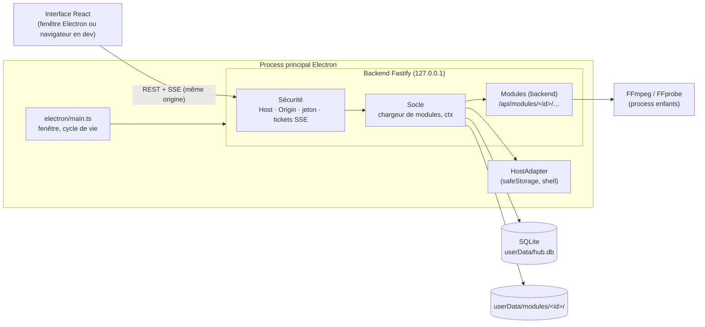
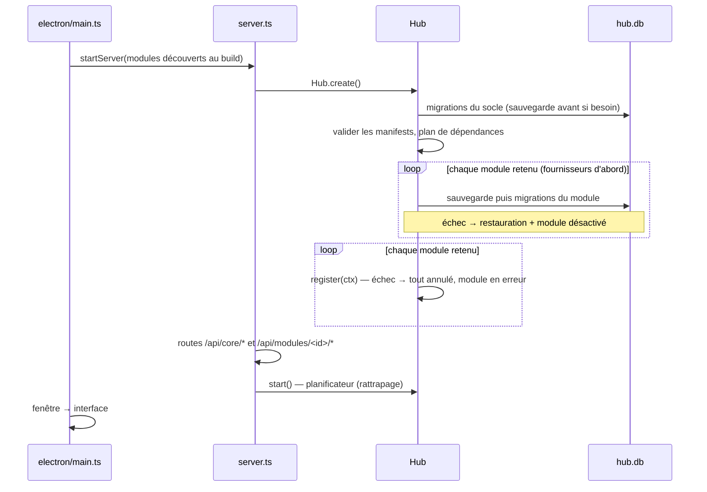

# Architecture

## Vue d'ensemble

ToolBox est une application Electron dont le process principal héberge un **backend HTTP local** (Fastify). L'interface React ne communique **qu'avec ce backend, via une API REST** : elle n'a aucun accès direct à Node, au disque ou à Electron. C'est ce qui permet de développer l'interface dans un navigateur classique.



| Couche         | Dossier         | Rôle                                                                                                                                         |
| -------------- | --------------- | -------------------------------------------------------------------------------------------------------------------------------------------- |
| Coquille       | `electron/`     | Crée la fenêtre, démarre le backend, fournit le `HostAdapter` (chiffrement, dialogues, ouverture de dossiers, redémarrage), preload minimal. |
| Socle backend  | `backend/`      | Serveur Fastify, sécurité, `Hub` (chargeur de modules, services `ctx`, migrations, sauvegardes), API `/api/core/*`.                          |
| Socle frontend | `frontend/`     | Shell : accueil par sections, navigation, pages Tâches, Journaux, Réglages ; héberge les pages des modules.                                  |
| SDK            | `packages/sdk/` | Le contrat vu par les modules : types, `ctx`, client API, hooks, composants. Seul import autorisé aux modules.                               |
| Modules        | `modules/<id>/` | Outils métier, branchés sur le socle par le contrat de [MODULES.md](MODULES.md).                                                             |

Le socle (`electron/`, `backend/`, `frontend/`, `packages/sdk/`) est **générique** : il ne connaît aucun module en particulier. Une règle ESLint interdit au socle d'importer un module, et aux modules d'importer autre chose que le SDK.

## Le socle backend

| Fichier                                    | Rôle                                                                                               |
| ------------------------------------------ | -------------------------------------------------------------------------------------------------- |
| `backend/server.ts`                        | Construit Fastify : sécurité, routes du socle, routes des modules, interface statique              |
| `backend/core/hub.ts`                      | **Hub** : ouvre la base, applique les migrations, charge les modules, construit leur `ctx`         |
| `backend/core/modules/`                    | Validation des manifests (zod), plan de dépendances, montage isolé des routes                      |
| `backend/core/migrations.ts`, `backups.ts` | Migrations préfixées et transactionnelles ; sauvegarde, rotation, restauration de `hub.db`         |
| `backend/core/settings.ts`                 | Réglages du socle et des modules (`core__settings`), secrets chiffrés via `HostAdapter`            |
| `backend/core/jobs.ts`, `scheduler.ts`     | Tâches longues (file, progression, annulation) ; tâches périodiques avec rattrapage                |
| `backend/core/events.ts`, `services.ts`    | Bus d'événements et registre de services entre modules                                             |
| `backend/core/logger.ts`                   | Journaux JSON lines dans `userData/logs/` (fichiers : ils survivent à une restauration de la base) |
| `backend/core/export.ts`                   | Export d'une sauvegarde complète en `.zip`                                                         |
| `backend/routes/core.ts`                   | API générique `/api/core/*`                                                                        |

### Séquence de démarrage



Les migrations de **tous** les modules passent avant le premier `register()` : restaurer une sauvegarde rouvre la base, ce qui ne doit jamais arriver sous des modules déjà actifs.

### API du socle

| Route                                                                                            | Rôle                                                                 |
| ------------------------------------------------------------------------------------------------ | -------------------------------------------------------------------- |
| `GET /api/health`                                                                                | Vivacité (sans jeton)                                                |
| `GET /api/core/system`                                                                           | Versions (app, SQLite, FFmpeg), dossier de données                   |
| `GET /api/core/modules` · `PUT /api/core/modules/:id/enabled`                                    | État des modules ; activer/désactiver (au redémarrage)               |
| `POST /api/core/restart`                                                                         | Redémarre l'app                                                      |
| `GET /api/core/settings` · `PUT /api/core/settings/:scope`                                       | Réglages (schéma + valeurs, secrets masqués) ; enregistrement validé |
| `POST /api/core/dialogs/select-folder` · `POST /api/core/dialogs/select-files`                   | Sélecteurs natifs de dossier et de fichiers                          |
| `GET /api/media/:jeton/:nom`                                                                     | Fichier multimédia par URL signée (sans jeton de session)            |
| `GET /api/core/jobs` · `POST /api/core/jobs/:id/cancel` · `GET /api/core/jobs/stream` (SSE)      | Tâches longues                                                       |
| `GET /api/core/logs`                                                                             | Journaux filtrés                                                     |
| `GET /api/core/outputs` (`?module=`, `?subject=`, `?missing=1`)                                  | Fichiers générés de tous les modules, vérifiés sur le disque         |
| `POST /api/core/outputs/delete` · `/forget` (`{ ids }`) · `/clean-missing`                       | Corbeille / retirer de la liste / oublier les introuvables           |
| `POST /api/core/outputs/:id/open` · `/:id/reveal`                                                | Ouvrir un fichier généré / le montrer dans l'Explorateur             |
| `GET /api/core/backups` · `POST /api/core/backups/export` · `POST /api/core/backups/open-folder` | Sauvegardes                                                          |
| `POST /api/core/stream-tickets`                                                                  | Ticket à usage unique pour un flux SSE                               |
| `POST /api/core/open-data-dir`                                                                   | Ouvre le dossier de données                                          |

## Pourquoi le backend tourne dans le process principal

- `safeStorage` (chiffrement des jetons) n'existe que dans le process principal.
- Le backend ne fait pas de calcul lourd : les rendus vidéo et l'analyse audio sont des process FFmpeg enfants.
- Un seul process à gérer, un seul runtime Node (celui d'Electron).

Voir `docs/decisions/0001-electron-backend-dans-le-main.md`.

## Même origine, partout

| Mode             | Qui sert l'interface                             | URL chargée                          | Accès à l'API                  |
| ---------------- | ------------------------------------------------ | ------------------------------------ | ------------------------------ |
| Production       | le backend (`@fastify/static`, `build/renderer`) | `http://127.0.0.1:<port aléatoire>/` | relatif (`/api/...`)           |
| Dev (Electron)   | Vite (rechargement à chaud)                      | `http://localhost:5173/`             | proxy Vite → `127.0.0.1:47321` |
| Dev (navigateur) | Vite                                             | `http://localhost:5173/`             | idem, le proxy ajoute le jeton |

L'interface et l'API étant toujours servies depuis la même origine, **aucun en-tête CORS n'est jamais émis**.

## Sécurité de l'API locale

Une API sur `localhost` est joignable par tout process local et par toute page web ouverte dans le navigateur de l'utilisateur. Protections (`backend/core/security.ts`) :

1. **En-tête `Host`** : seuls `127.0.0.1:<port>` et `localhost:<port>` sont acceptés (protection contre le _DNS rebinding_).
2. **`Origin` et `Sec-Fetch-Site`** : une requête portant une origine étrangère ou marquée `cross-site` est refusée (protection CSRF). Les origines autorisées sont celle du backend, plus celle de Vite en dev.
3. **Jeton de session** : chaque route `/api/*` (sauf `/api/health`) exige l'en-tête `x-toolbox-token`. Le jeton est aléatoire (32 octets), régénéré à chaque lancement, et transmis à l'interface par le preload (`window.toolbox.token`). En dev navigateur, c'est le proxy Vite qui l'ajoute (`scripts/dev.mjs` le génère et le partage avec Electron).

### Flux SSE et tickets à usage unique

`EventSource` (Server-Sent Events, utilisé pour la progression des tâches) **ne peut pas envoyer d'en-têtes personnalisés**. Le jeton ne passe donc pas tel quel :

1. L'interface demande un ticket : `POST /api/core/stream-tickets` (avec le jeton en en-tête) → `{ "ticket": "…" }`.
2. Elle ouvre `new EventSource('/api/…?ticket=…')`.
3. Le backend accepte le ticket **une seule fois**, s'il a moins de **30 secondes**, et **uniquement** sur une route `GET` déclarée avec `config: { streamTicket: true }`.

Un ticket ne vaut donc que pour ouvrir un flux, et ne peut être ni rejoué ni utilisé sur une autre route. Pour se reconnecter après une coupure, l'interface redemande un ticket (la reconnexion automatique d'`EventSource` réutiliserait un ticket consommé : le client gère la reconnexion lui-même).

### Ce que le preload expose

L'interface n'a accès qu'à trois choses hors de l'API REST (`electron/preload.ts`) : le jeton de session, le chemin réel d'un fichier glissé **dans** la fenêtre (`webUtils.getPathForFile`), et le glisser d'un fichier **hors** de la fenêtre (`startDrag`). Ce dernier ne reçoit qu'une URL de média signée : le process principal en vérifie la signature (`hub.media.resolve`) avant d'appeler `webContents.startDrag`, si bien qu'une page ne peut pas faire glisser un fichier arbitraire.

### Fichiers multimédias : URL signées

``, `<audio>` et `<video>` ne peuvent pas non plus envoyer le jeton. Le backend leur fournit des URL `/api/media/<jeton>/<nom>` (`backend/core/media.ts`, `ctx.files.mediaUrl()`) : le jeton contient le chemin du fichier et une signature HMAC dont la clé est tirée au hasard à chaque lancement. Ces URL ne peuvent pas être fabriquées, expirent au redémarrage et ne couvrent que les dossiers du hub (données des modules, dossier de sortie, assets des modules). Elles gèrent la lecture par morceaux (en-tête `Range`), nécessaire pour se déplacer dans un morceau ou une vidéo.

## Données

| Donnée                     | Emplacement (Windows)                                                                                                                                                 |
| -------------------------- | --------------------------------------------------------------------------------------------------------------------------------------------------------------------- |
| Base SQLite                | `%APPDATA%\ToolBox\hub.db` (tables `core__*` du socle, `<module>__*` des modules)                                                                                     |
| Fichiers des modules       | `%APPDATA%\ToolBox\modules\<id>\`                                                                                                                                     |
| Sauvegardes automatiques   | `%APPDATA%\ToolBox\backups\` (10 dernières, avant chaque migration)                                                                                                   |
| Journaux                   | `%APPDATA%\ToolBox\logs\` (14 jours)                                                                                                                                  |
| Fichiers générés (vidéos…) | dossier de sortie réglable (par défaut `Vidéos\ToolBox\<id>\`), registre `core__outputs` (vérifié au démarrage et à chaque affichage ; suppression vers la Corbeille) |
| Application                | dossier d'installation, en lecture seule                                                                                                                              |

Rien n'est jamais écrit dans le dossier d'installation. La variable `TOOLBOX_USER_DATA_DIR` permet d'utiliser un profil isolé (tests, CI).

## Build et packaging

```
frontend/ + modules/*/frontend ──vite build──▶ build/renderer/
electron/ + backend/ + modules/*/backend ──esbuild──▶ build/main/main.cjs, preload.cjs
build/ + node_modules (dependencies) ──electron-builder──▶ dist/ToolBox-Setup-x.y.z.exe, ToolBox-Portable-x.y.z.exe
```

- **Découverte des modules au build** : côté backend, le plugin esbuild `virtual:toolbox-modules` (`scripts/esbuild-config.mjs`) génère la liste des dossiers `modules/*/module.json` avec leur `backend/index.ts` ; côté interface, `import.meta.glob` (`frontend/src/modules/registry.ts`). Un nouveau dossier demande de relancer `npm run dev`.
- esbuild bundle le main, le backend et les modules ; les `dependencies` du `package.json` restent externes et sont livrées dans `node_modules`.
- `ffmpeg-static`, `@derhuerst/ffprobe-static` et `better-sqlite3` sont dépaquetés de l'archive asar (`asarUnpack`). `toUnpackedPath()` corrige le chemin renvoyé par les paquets.
- La CI (`.github/workflows/build-windows.yml`) lance lint, typecheck, tests, vérification native, build, puis un **smoke test du `.exe` empaqueté** (`ToolBox.exe --smoke-test=<fichier>`) qui vérifie l'API, SQLite, FFmpeg, FFprobe, le chargement du module modèle (migration + route) et de l'interface.

## Gestion des erreurs

- Échec au démarrage du socle (ex. migration du socle) : boîte de dialogue explicite, puis sortie.
- Un module en erreur (manifest, dépendance, migration, `register()`, route, tâche, affichage) n'affecte que lui : détail dans [MODULES.md §9](MODULES.md#9-gestion-des-erreurs--ce-qui-ne-fait-pas-tomber-le-hub).
- Exceptions non gérées du process principal : consignées dans les journaux, l'app continue.
- Une seule instance de l'app à la fois (la seconde remet la première au premier plan).
- Fermeture : le hub s'arrête proprement (tâches interrompues, connexions SSE fermées) en 5 s maximum, puis l'app quitte.
